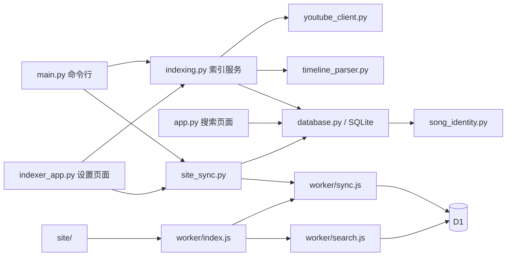

# 架构与维护边界

项目有三个本地入口和一个线上入口。本地 SQLite 是索引数据的来源，线上 D1 是通过快照或补丁同步的检索副本。

## 模块职责

| 层 | 文件 | 职责与依赖约束 |
| --- | --- | --- |
| 本地入口 | `main.py`、`app.py`、`indexer_app.py` | 参数、HTTP、展示和任务生命周期；调用服务，不复制索引规则 |
| 索引服务 | `indexing.py` | 扫描窗口、额度、重试、回填、时间轴选择和统计；不加载环境配置，不启动服务，不直接同步站点 |
| 数据访问 | `database.py` | SQLite 建表与兼容迁移、索引状态持久化、事务、分组检索 |
| 纯解析 | `timeline_parser.py`、`song_identity.py` | 时间轴、歌曲和作者身份；不访问网络或数据库 |
| 外部适配 | `youtube_client.py`、`site_sync.py` | YouTube 请求与错误分类；快照导出、行级差异、站点上传与基线 |
| Worker 入口 | `worker/index.js` | URL/方法分派、静态资源和 HTTP 错误映射 |
| Worker 服务 | `worker/search.js`、`worker/sync.js` | 搜索与分页；经过令牌验证的暂存、提交和版本切换 |
| HTTP 公用代码 | `worker/http.js` | 响应头、响应格式、请求字符串读取；不承载业务状态 |
| 配置与资源 | `config.py`、`templates/`、`static/`、`site/` | 本地配置、Flask 页面、线上页面 |

设置页交互单独放在 `static/setup.js`，模板只通过 `data-*` 提供路由与自动退出配置。添加/更新、删除、独立同步共用请求互斥与状态轮询；后端共用线程启动、同步与本地结果完成处理。`local_changed` 单独记录本地结果，不能用整体任务的 `ok` 推断本地删除是否生效。

Python 模块保留在仓库根目录，兼容 `python main.py`、两个 Flask 入口及 PyInstaller 打包路径。`main.py` 保留原有索引函数的导入兼容性，新代码直接从 `indexing` 导入。不要让业务模块反向依赖入口或 Flask 全局状态。

## 数据与事务

本地关系是 `channels → videos / songs → song_entries`。频道删除和单视频时间轴替换各自在一个事务内完成。扫描状态单独持久化，因此程序退出后可以继续处理；请求失败不能冒充已完成。

删除事务在读取确认名称和计数前取得写锁。时间轴按 `(video_id, seconds, normalized_song_title)` 对账，保留仍有效的 ID，结束后才清理孤立歌曲。视频元数据未变化时不刷新导出时间戳。导出在一个显式读事务中完成，避免分组和后续表读取跨越并发写入。

D1 的结构来源是 `db/schema.ts`，可执行迁移在 `drizzle/`。Worker 的暂存表属于同步协议，由 `worker/sync.js` 按需建立。所有 Worker 行为测试都通过 `tests/helpers/worker_db.mjs` 执行真实迁移，不再维护另一套手写测试表结构。

全量导入先写版本化暂存表，校验完整性后在一个 D1 batch 中替换线上表。补丁同样先暂存，再校验活动版本、基线和操作数；删除与 upsert 在一个 batch 内完成。歌曲分组键可能因作者补全或频道删除而变化，所以补丁事务使用 `PRAGMA defer_foreign_keys = ON`，将引用检查延后到提交；最终存在悬空引用时整批回滚。该机制遵循 [D1 外键文档](https://developers.cloudflare.com/d1/sql-api/foreign-keys/)，不会关闭外键约束。

本地同步基线以站点地址隔离，远端成功后才写入完整标记。同步失败必须保留上次成功基线，防止下一次运行错误地跳过上传。

## 构建产物

`worker/` 和 `site/` 是源码。`scripts/worker-build.mjs` 使用明确锁定的 esbuild 版本打包模块并嵌入页面资源，输出单文件 ES module。`scripts/build-worker.mjs` 将它及迁移、hosting 配置生成到 `dist/`。

仓库延续提交 `dist/` 的部署约定。禁止直接修改生成文件；修改源码后执行 `npm run build`。`npm run validate` 会重建内存中的 bundle 进行比较，检查迁移和配置副本，并实际调用 bundle 的静态路由确认内容一致。CI 再检查 `dist/` 没有未提交的生成差异。

`.env`、SQLite、日志、同步基线、虚拟环境和 EXE 均为本地运行数据，不纳入版本控制。便携版输入放在 `packaging/`，产物放在 `build/portable/`。

## 检查与扩展

统一入口是 `python scripts/check.py`；支持 `--scope python` 和 `--scope site`。它使用当前 Python 环境运行 Python 测试和 Worker 的 SQLite 桥接程序，编译范围只包含维护的 Python 源码。测试使用内存库或临时目录，不调用真实 YouTube API、不上传站点。

- 搜索规则：维护 `tests/fixtures/search_contract.json` 和 `artist_contract.json`。作者契约既验证本地检索，也通过真实 Python 导出、D1 迁移、Worker 导入和两个查询 API 验证。
- 索引规则：覆盖中断恢复、批次边界、过滤条件变化和失败退避，不能只测一次运行。
- 同步规则：覆盖正常切换、引用迁移、缺失批次、过期版本、失败回滚及基线保留。
- 频道操作：`tests/test_channel_operations.py` 覆盖添加/更新/删除/重新添加、无变化导出、并发快照和同步重试；`test_setup_ui.mjs`、`test_site_ui.mjs` 验证请求次数、页面状态和异步竞态。轻量 DOM 替身不验证浏览器布局。
- 表结构变更：修改 `db/schema.ts` 后生成迁移；本地 SQLite 的兼容逻辑在 `database.py` 中维护。说明旧数据是否需要重建或重新导出。
- 功能变更：同步更新 [功能契约](features.md)、使用文档和 CHANGELOG。

SQLite 桥接测试验证 SQL 和事务行为，不能替代真实 D1 的配额、延迟和部署验证。发布前应在自己的测试站点验证一次导入、搜索和增量同步。
